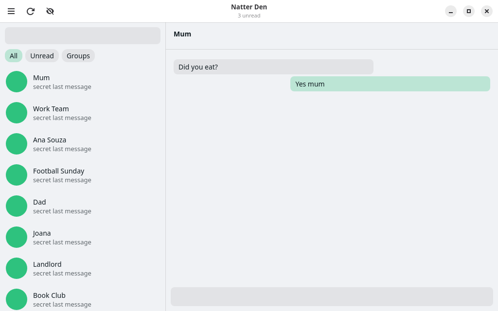
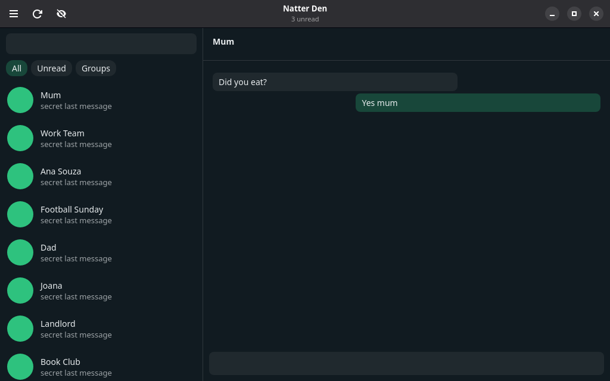

# Natter Den

<p>
  
  
</p>

*Shown with the test page (tests/mock-whatsapp.html) in place of WhatsApp, so no real chats appear.*

WhatsApp for Linux that feels like part of your desktop. Natter Den shows WhatsApp Web in
a native GTK 4 / libadwaita window and connects it to the rest of the desktop:
notifications, the dock, the tray and the keyboard. It works on GNOME, KDE Plasma, Xfce,
Sway, Ada and the rest.

Natter Den is unofficial: it isn't made by, endorsed by or affiliated with WhatsApp or Meta. It
runs the real WhatsApp Web and nothing else, the same way your browser would.

## Install

```sh
curl -fsSL https://raw.githubusercontent.com/Officialbabs/natter/master/get.sh | sh
```

Then open Natter Den from your apps and scan the code with WhatsApp on your phone (*Settings →
Linked devices*). To update, run the same command again.

That works as it is on Ubuntu 24.04, Debian 13, Fedora 40, Arch, openSUSE Tumbleweed and their
newer releases and derivatives. If a package is missing, it says which, and the command that
installs it.

- **Older systems** (Ubuntu 22.04, Debian 12, openSUSE Leap 15), **Fedora Atomic and Bazzite:**
  get the Flatpak instead, which brings everything it needs:
  ```sh
  curl -fsSL https://raw.githubusercontent.com/Officialbabs/natter/master/get.sh | sh -s -- --flatpak
  ```
- **Uninstall:** `~/.local/lib/natter/source/install.sh --uninstall && rm -rf ~/.local/lib/natter`.
  The Flatpak: `flatpak uninstall --user io.github.Officialbabs.Natter && rm -rf ~/.local/lib/natter/source ~/.cache/natter-den-flatpak`.
  Your WhatsApp sessions stay in `~/.local/share/natter` (the Flatpak's in
  `~/.var/app/io.github.Officialbabs.Natter`) until you delete them.

[get.sh](get.sh) installs Natter Den for you alone: it downloads the latest version into
`~/.local/lib/natter/source` (no git needed) and runs its `install.sh`, which lists anything your system is
missing and asks once before installing it with your package manager (`sudo` asks for your
password). To read it first, download it and run `sh get.sh`. The steps by hand are in
[Install in detail](#install-in-detail).

## What it does that a browser tab (or ZapZap) doesn't

| | |
|---|---|
| **Native** | libadwaita window in the system's light or dark style (or the one you pick), on the system's WebKitGTK instead of a bundled Chromium. |
| **One notification per chat** | New messages replace that chat's notification and add a count, with the sender's picture. Clicking one opens that exact chat. *Mute for an hour* is right on the notification. |
| **Quiet hours** | No notifications in a time window you choose; the unread count still updates. |
| **Do not disturb** | From the tray or Ctrl+K: pause notifications for an hour, two, or until you turn them back on. |
| **Unread count** | In the tray, on each account's tab, and on the dock icon where the dock shows badges. |
| **Ctrl+K** | Jump to any chat by typing part of its name. Type a phone number to message someone without saving them. Commands too. |
| **Recent chats in the dock** | Right-click Natter Den's dock icon to open one of your five most recent chats. |
| **Paste and drop pictures and files** | Ctrl+V a screenshot, an image copied from any app, or files copied in the file manager, or drag files onto a chat, and WhatsApp shows its preview with a caption box. With no chat open, Natter Den asks where to send them. |
| **Send files from anywhere** | Drop files on Natter Den's dock icon (or `natter FILE…`), pick the chat, and WhatsApp shows its preview with a caption box. |
| **WhatsApp links** | `wa.me/…`, `api.whatsapp.com/send…` and `whatsapp://` links open in Natter Den, both from other apps and from inside chats, and so do group invites (`chat.whatsapp.com/…`, with WhatsApp's own *Join group* preview) and channels (`whatsapp.com/channel/…`). Other links open in your browser. |
| **Themes** | In Preferences → Appearance: Den (the default, in the icon's orange); WhatsApp's own 22 chat themes, with WhatsApp's names and colours in the order its picker has them (WhatsApp green, Pearl indigo, Tyrian purple, Sunset orange, Merino teal, Royal blue, Dark cerulean, Charcoal green, Persian plum, Dune mono, Default blue, Default mono, Sky blue, Brown, Cream, Emerald, Lemon, Lime, Pink, Red, Sunrise orange, Warm yellow); Custom, a theme in any colour you pick, made the way WhatsApp makes its own; or Plain for WhatsApp's and your system's own colours. Each recolours the accent, links, read ticks, sent bubbles and chat background on WhatsApp's page and the accent in Natter Den's window, in light and dark, and switches live. Light, Dark or Follow System passes through to WhatsApp; on Ada, Follow System follows Ada's own Light, Dark or Dune. Themes only redefine WhatsApp's colour names in a local style sheet: nothing is loaded, clicked or stored in WhatsApp ([how](#themes)). |
| **Privacy blur** | Ctrl+Shift+B blurs names, pictures and messages until you point at them. It can also blur everything while Natter Den is in the background. |
| **App lock** | A passcode keeps WhatsApp out of sight: when Natter Den starts, when its window closes, or after being idle; Ctrl+L locks it now. While it's locked, notifications don't say who wrote or what, and recent chats leave the dock and search. |
| **Microphone and camera** | Switches in Preferences → Privacy, the main menu and Ctrl+K turn them off for WhatsApp, the way a browser blocks a site; turned off during a call, that device stops at once. If your desktop has blocked the camera, Natter Den says so and can have your desktop ask again (in the Flatpak, it shows where to allow it). |
| **Multiple accounts** | Each with its own session. Ctrl+1, Ctrl+2… switch between them. |
| **Stays out of the way** | Closing the window keeps Natter Den in the tray. It can start hidden at login. The tray menu keeps to the essentials: show or hide, privacy blur, pause notifications, lock and quit. |
| **Lighter** | A third to nearly half less memory than ZapZap and Whatsie with the same account ([measured](#natter-den-and-zapzap-side-by-side)). |
| **Light in the background** | While the window is closed, Natter Den hands memory WhatsApp isn't using back to the system, and keeps running so messages still arrive. |
| **One process group** | Natter Den and its WebKit processes run in one systemd unit, however it was started, so the task manager shows them as one app. |
| **Desktop search** | Answers `org.gnome.Shell.SearchProvider2` with your chats by name, for desktops that ask apps for search results. See [docs/ada.md](docs/ada.md). |

**Calls** happen in Natter Den, with WhatsApp's own call buttons in the chat. WebKitGTK as
distributions build it has no WebRTC, but WhatsApp's calls only use one part of it, data
channels: its own call engine makes and encrypts the sound and pictures in the page. Natter Den
gives the page those data channels, done by GStreamer, so calls run in the same WhatsApp page
as everything else, with no second browser behind it. That needs GStreamer's WebRTC plugins
(see [Install by hand](#by-hand)); without them, calls open in your browser. Calls are new:
voice calls work, and video calls are still being finished.

The camera is found even when the desktop is slow to answer. WebKitGTK 2.52 asks the desktop's
camera portal for it and gives the portal 10 ms; on a busy computer the answer came late and
WhatsApp said "Camera not found". Natter Den lets WebKit find the camera itself then, with udev's
notes on each device (read-only in WebKit's sandbox), and as that way doesn't ask the desktop,
Natter Den keeps the desktop's answer for the camera itself: its "no", its camera switch for all
apps, and, with nothing stored yet, it has the desktop ask before WhatsApp gets the camera. (In
the Flatpak it's the portal's answer, as before.) With GStreamer 1.28 or newer, WebKit's camera
picture also freezes on its first frame
([WebKit bug 324582](https://bugs.webkit.org/show_bug.cgi?id=324582)): `install.sh` builds a small
GStreamer plugin that prevents it, if a C compiler, `pkg-config` and GStreamer's headers are there
(on Ubuntu and Debian: `sudo apt install build-essential pkg-config libgstreamer1.0-dev`).
`NATTER_CAMFIX=0` turns it off.

## On your desktop

Natter Den speaks the freedesktop standards, so most of it works everywhere. What depends on the
desktop:

| | GNOME | KDE Plasma | Ada | Xfce | Sway |
|---|---|---|---|---|---|
| Notifications, one per chat, click to open | ✓ | ✓ | ✓ | ✓ | ✓ with a notification daemon (mako, dunst, SwayNC) |
| Tray icon with unread count and menu | with the AppIndicator extension (on by default in Ubuntu) | ✓ | ✓ | ✓ Status Tray plugin | ✓ Waybar's tray; swaybar's shows the icon and opens Natter Den on a click, but has no menu |
| Unread badge on the dock icon | Ubuntu Dock, Dash to Dock | ✓ | ✓ | – | – |
| Recent chats in the dock's right-click menu | ✓ | ✓ | ✓ | – | – |
| Chats in desktop search | ✓ Activities search, while Natter Den runs | – | ready ([docs/ada.md](docs/ada.md)) | – | – |
| Start hidden at login | ✓ | ✓ | ✓ | ✓ | if your session runs XDG autostart (`dex -a`, systemd's autostart generator) |
| Window comes forward from a notification | ✓ | ✓ | ✓ | ✓ | if the daemon passes an activation token |
| One process group, memory back while hidden | ✓ | ✓ | ✓ | ✓ with a systemd user session | ✓ with a systemd user session |

Without a tray, a Natter Den running in the background would be out of sight, so on a desktop
with no tray host closing the window quits it, unless you've turned *Keep Running When
Closed* on yourself.

Giving memory back while hidden also needs cheap swap: zram (Fedora's default) or zswap.
Without either, pages would go to a swap file or partition on disk and come back slowly, so
Natter Den leaves memory alone.

In the Flatpak, notifications go through the notification portal, start at login goes
through the Background portal (where the desktop's portals offer it, as GNOME's and KDE's do;
elsewhere the switch turns itself back off), and the dock badge and recent chats in the dock
menu aren't available (the tray shows the count). Desktop search works the same.

## Install in detail

[The command above](#install) does what this section says, for you. These are the steps by hand.

### Flatpak

The Flatpak brings its own GTK, libadwaita, WebKitGTK and codecs, so it runs on any
distribution, old ones included. It needs `flatpak` and `flatpak-builder` (on Ubuntu and Debian:
`sudo apt install flatpak flatpak-builder`) and the Flathub remote. To build and install it from
Natter Den's source folder, for you alone (`get.sh --flatpak` does the same, building in
`~/.cache/natter-den-flatpak`):

```sh
flatpak remote-add --user --if-not-exists flathub https://dl.flathub.org/repo/flathub.flatpakrepo
flatpak install --user flathub org.gnome.Sdk//50 org.gnome.Platform//50
flatpak-builder --user --install --force-clean build-flatpak packaging/io.github.Officialbabs.Natter.yml
flatpak run io.github.Officialbabs.Natter
```

### By hand

Natter Den needs Python 3 with PyGObject and these, or newer:

| | Oldest |
|---|---|
| GTK | 4.14 |
| libadwaita | 1.5 |
| WebKitGTK (6.0 API) | 2.42 |
| PyGObject | 3.42 |
| libsoup | 3.0 |
| GdkPixbuf | 2.0 |

Ubuntu 24.04, Debian 13, Fedora 40, Arch and openSUSE Tumbleweed have them (and their newer
releases and derivatives: Linux Mint 22, Pop!_OS 24.04 and so on). On Debian 12, Ubuntu 22.04
or openSUSE Leap 15, use the Flatpak. Use it too on systems that install apps as Flatpaks:
Fedora Atomic (Silverblue, Kinoite…), Bazzite and SteamOS (on Fedora Atomic, `rpm-ostree install`
can layer the packages instead), and on Mageia or OpenMandriva, whose packages Natter Den doesn't
know by name. Natter Den checks when it starts and says what's missing.

The packages, with the GStreamer codecs WhatsApp's videos (H.264, AAC) and voice messages
(Opus) need, and GStreamer for Python, which Natter Den uses to check for those codecs:

```sh
# Debian, Ubuntu and derivatives
sudo apt install python3-gi gir1.2-gtk-4.0 gir1.2-adw-1 gir1.2-webkit-6.0 gir1.2-soup-3.0 \
                 gir1.2-gdkpixbuf-2.0 gir1.2-gstreamer-1.0 gstreamer1.0-libav gstreamer1.0-plugins-good
# Fedora (GStreamer for Python comes with gstreamer1)
sudo dnf install python3-gobject gtk4 libadwaita webkitgtk6.0 libsoup3 \
                 gstreamer1-plugin-openh264 gstreamer1-plugin-libav
# Arch and derivatives (GStreamer for Python comes with gstreamer)
sudo pacman -S --needed python-gobject gtk4 libadwaita webkitgtk-6.0 libsoup3 gst-libav gst-plugins-good
# openSUSE
sudo zypper install python3-gobject python3-gobject-Gdk typelib-1_0-Gtk-4_0 typelib-1_0-Adw-1 \
                    typelib-1_0-WebKit-6_0 typelib-1_0-Soup-3_0 typelib-1_0-Gst-1_0 \
                    gstreamer-plugin-openh264 gstreamer-plugins-libav
```

For calls inside Natter Den, also GStreamer's WebRTC parts and their Python bindings: the "bad"
plugins (webrtcbin, SCTP, DTLS, SRTP), libnice's GStreamer plugin, and the GstWebRTC and GstSdp
introspection data. Without them Natter Den still runs, and calls open in your browser.

```sh
# Debian, Ubuntu and derivatives
sudo apt install gstreamer1.0-plugins-bad gstreamer1.0-nice gir1.2-gst-plugins-bad-1.0 gir1.2-gst-plugins-base-1.0
```

Then download Natter Den and install it (this is what the one-line command does):

```sh
mkdir -p ~/.local/lib/natter/source && cd ~/.local/lib/natter/source
curl -fsSL https://github.com/Officialbabs/natter/archive/refs/heads/master.tar.gz | tar -xz --strip-components=1
./install.sh   # adds Natter Den to your apps and `natter` to ~/.local/bin
```

`install.sh` checks what Natter Den needs. If packages are missing, it lists them in three
groups and asks once whether to install them with your package manager (apt-get, dnf, pacman or
zypper, through `sudo`):

- **Required:** for Natter Den to run.
- **Recommended:** the codecs WhatsApp's videos and voice messages need, and GStreamer's WebRTC
  parts for calls.
- **Optional:** a compiler and GStreamer's headers, to build the camera fix. Asked for only with
  GStreamer 1.28 or newer.

It asks on the terminal, so it also works through `curl … | sh`. Then it picks the Python that
has everything (the system's `/usr/bin/python3` first), writes `~/.local/bin/natter` for it,
pointing at this folder, and installs the menu entry, icons, desktop search files and the
`whatsapp://` handler (unless another app already has it). It says if `~/.local/bin` isn't on
your `PATH`. While Natter Den is running it stops and asks you to quit it first; `--force` goes
ahead anyway. `--yes` installs missing packages without asking; `--no-deps` never installs (it
prints the command and stops if a required package is missing), and neither does a run with no
terminal to ask on. On a release too old for Natter Den (Ubuntu 22.04, Debian 12, openSUSE
Leap 15…) it says so and points to the Flatpak. The package names for each distribution are in
`natter/distro.py`.

Open Natter Den and scan the code with WhatsApp on your phone (*Settings → Linked devices*).
To update, run the one-line command again. `./install.sh --uninstall` removes it all;
your sessions stay in `~/.local/share/natter` until you delete that folder.

### Packages

`meson.build` installs Natter Den the way distribution packages want it: the `natter` package in
`/usr/share/natter`, the `natter` command, desktop file, icons, AppStream metainfo, D-Bus
service and search provider. The Flatpak builds with it too. On Arch and its derivatives,
[packaging/aur/natter-den-git](packaging/aur/natter-den-git) has a PKGBUILD (`makepkg -si`); it isn't on
the AUR yet.

```sh
meson setup build --prefix=/usr && meson install -C build
```

### Coming from io.natter.Natter

Natter Den's app id is now `io.github.Officialbabs.Natter` (it was `io.natter.Natter`). Quit the
old Natter first (*Quit* in its tray menu, or Ctrl+Q in its window): `./install.sh` stops while
it's running, since both would use the same WhatsApp session. Then run `./install.sh` again: it
removes the old menu entry, icons and search files, moves start-at-login over to the new name,
and moves the `whatsapp://` handler if it was the old one's. Your accounts, chats and settings stay
where they were, so there's nothing to link again. Docks remember apps by id, so pin Natter Den
again. (With `./install.sh --force` and the old Natter still running, the new one won't open
WhatsApp until the old one quits: it brings the old window forward instead.)

On Ada, if you let the old Natter run in the background by adding `io.natter.Natter` to
`AllowBackground` in `~/.config/os-ai/lifecycle.ini` (Ada's background allow list), replace it
there with `io.github.Officialbabs.Natter`. `./install.sh` reminds you when the old id is still
in that file; it doesn't change the file itself.

## Use

```sh
natter                       # open (or bring forward)
natter --background          # start hidden: notifications and the tray still work
natter --chat "Mum"          # open a chat by name
natter https://wa.me/1555…   # open a chat by number
natter photo.jpg report.pdf  # send files: pick the chat, then caption and send
```

| Keys | |
|---|---|
| Ctrl+K | Go to chat, message a number, run a command |
| Ctrl+Shift+B | Privacy blur |
| Ctrl+1 … Ctrl+9 | Switch account |
| Ctrl+, | Preferences |
| Ctrl+plus / minus / 0 | Zoom |
| Ctrl+W / Ctrl+Q | Hide / quit |

WhatsApp's own shortcuts (Ctrl+Alt+N for a new chat, and so on) work as usual.

## How it works

Each account is a WebKit network session with its own folder in
`~/.local/share/natter/accounts/<id>/`. Natter Den's folders (`~/.config/natter`,
`~/.local/share/natter`, `~/.cache/natter`) are readable by you only, and its settings and
chat lists are written whole, so a crash never leaves half a file. A small script
(`natter/bridge.js`) runs in WhatsApp Web before WhatsApp's own code and tells Natter Den:

- **notifications**: WhatsApp's `new Notification(…)` comes to Natter Den, which shows it over
  `org.freedesktop.Notifications` (or the notification portal in the Flatpak). A click goes back
  to the same object, so WhatsApp's own handler opens the chat.
- **the chat list**: the names of the chats WhatsApp shows, and their order. Natter Den keeps
  the names (never message text) in `chats.json` for Ctrl+K, the dock menu and desktop search.
  WhatsApp only keeps the visible rows in the page, so older chats show up once you've scrolled
  past them.
- **the unread count**: from the page title.
- **calls**: a press on WhatsApp's call buttons, which Natter Den hands to the browser.

To open a chat by name, the bridge clicks its row, or types the name into WhatsApp's search
box and clicks the result. Files go in as a paste into the message box (Ctrl+V) or a drop on the
open chat. WhatsApp's Content-Security-Policy won't let its page fetch anything from Natter Den, so
Natter Den hands the bytes over itself, 4 MB per call, and the bridge puts the file back together.
Files dragged onto the window are caught by Natter Den (WhatsApp's page is sandboxed and can't read
them), and the bridge hides that drag from WhatsApp, which would otherwise show its drop zone
for a drop that never arrives and then ignore the files Natter Den hands it.

The tray is a StatusNotifierItem with a dbusmenu, the badge uses the Unity LauncherEntry API,
and the dock menu is written as `[Desktop Action]` entries into Natter Den's own `.desktop` file in
`~/.local/share/applications` (never into a package's or the Flatpak's), naming chats by a
hash rather than by name on the command line.

Desktop search answers from the chat lists on disk: a search doesn't start WhatsApp. The
provider file says `AutoStart=false`, so the desktop only asks a Natter Den that's already running.

### Themes

WhatsApp Web paints through its own colour names (`--WDS-accent`,
`--WDS-systems-bubble-surface-outgoing` and so on). WhatsApp's chat themes change a few of them
(the accent, links, read ticks, the sent bubble and the chat background; Default blue, Default mono
and Sky blue the bubbles' small grey text too). A Natter Den theme redefines those, the accent
names around them (the label on the accent, the brand colour, the chosen filter) and the start-up
screen's, and nothing else. `natter/themes.py` writes them;
`natter/account.py` hands the result to WebKit. WhatsApp's own themes are copied as colour values (their tonal form,
light and dark). Den is made the way WhatsApp makes its own: one ramp at the colour's hue with
WhatsApp green's lightness at every step, each name on the step green uses. Custom keeps the colour
you pick: it's the accent in light wherever white reads on it (3:1), or else the nearest colour of
the same hue and chroma that white reads on (a grey, a near-black or a colour more vivid than
WhatsApp's Red follows WhatsApp's own themes instead); in dark it's a step lighter, as WhatsApp's
own are.
Its other names come from a ramp at its hue, as colourful as the colour picked, with the chat
background's doodles no more colourful than WhatsApp's own most colourful ones.

The label on the accent is white on Den and Custom, in light and dark. WhatsApp's themes keep
WhatsApp's own label, white in light and near-black in dark, except Lemon, Warm yellow and Cream,
where white has under 3:1: WhatsApp keeps a chat theme to the open chat, but Natter Den paints it
across the page, so those fills also label the chat list's unread badges, and there the label is
near-black in light too. A pale yellow, cream or lime picked for Custom does the same, rather than
turn olive or tan. WhatsApp's surfaces and text keep WhatsApp's own colours, and the window keeps
libadwaita's greys, at most faintly turned towards the theme, with the page's accent and label.
Where that label is the near-black one, it's the knob of a switch that's on too: libadwaita
paints that knob white whatever the label, and white wouldn't show on those fills.

So a theme changes how WhatsApp looks and nothing else, it is:

- **A user style sheet and nothing more**: WebKit applies it at the user level to WhatsApp's
  pages, top frame only. It's never put in the page as an element, and no script changes the
  page for it (the bridge only reads whether WhatsApp's colour names are there).
- **Colour values only**: custom properties named `--WDS-*` or `--splashscreen-*`, every one
  `!important`, on `html`, `body`, `#main` and `body.dark` (`body.dark #main`) only. No `url()`,
  `@import` or `@font-face`, so nothing is loaded. Custom's colour must be `#rrggbb` to get in.
- **Never WhatsApp's own settings**: Natter Den doesn't read or write WhatsApp's storage
  (localStorage, sessionStorage, IndexedDB), doesn't turn on, choose or change WhatsApp's own chat
  theme, wallpaper or app theme or the flags behind them, doesn't call into WhatsApp's code and
  sends no events for a theme. It only paints, with CSS, what WhatsApp's free chat themes look like.

Plain adds no style sheet at all. The tests (`tests/test_themes.py`, `tests/test_theme_wiring.py`)
hold the theme code to these rules.

## WebKit settings, and why

- **No service worker.** WhatsApp's service worker passes every download through itself, and in
  WebKitGTK (2.52) some arrive damaged: emoji sprite sheets drew as slivers, blank cells and
  magnified squares, different ones each start. Without it they draw whole. It only does
  offline caching, which a desktop app doesn't need.
- **A disk cache** (`DOCUMENT_BROWSER`), so WhatsApp's code isn't downloaded on every start: with
  it, the chat list is up in about 15 s instead of 25–150 s.
- **No process swapping or back/forward cache**: one site, no history.
- **Hardware acceleration** on, unless you turn it off in Preferences → *Troubleshooting* (for a
  blank or flickering page on some graphics drivers).

## Memory and CPU

### Natter Den and ZapZap side by side

Both running at once with the same WhatsApp account, idle, no calls, on one laptop (Intel
Core 5 120U, 16 GB, swap with zswap) on 19 October 2026: ZapZap 7.5.1 (Flatpak, Qt WebEngine
on org.kde.Platform 6.11) and Natter Den 0.1.0 (WebKitGTK 2.52.6).

| | ZapZap | Natter Den |
|---|---|---|
| In memory (PSS) | 1,236 MB | 1,000 MB |
| Moved out to swap | 680 MB | 215 MB |
| **Total** | **1,916 MB** | **1,215 MB** |
| CPU while idle (over 30 s) | 2.0% | 1.6% |
| Biggest process | web engine renderer, 1,044 MB | WebKit web process, 880 MB |
| The app's own process | 115 MB | 53 MB |

Natter Den used about 700 MB (37%) less memory at the same idle CPU. Just after starting the gap
was the same: 90 seconds in, ZapZap used 1,964 MB; Natter Den, 12 minutes in, 1,197 MB.

The same comparison a day later (20 October), now with Whatsie (Snap, Qt WebEngine) as a third
client — all three awake with the same account, idle, two 120 s windows after they had settled:

| | ZapZap | Whatsie | Natter Den |
|---|---|---|---|
| In memory (PSS) | 1,175–1,450 MB | 931–1,326 MB | 941–1,008 MB |
| Moved out to swap | 911–1,157 MB | 989–1,405 MB | 334–382 MB |
| **Total** | **~2,360 MB** | **~2,325 MB** | **~1,315 MB** |
| CPU while idle (over 120 s) | 2.4–3.1% | 5.9–6.0% | 3.5–3.7% |

Natter Den held about 44% less than either. Most of the difference is what sits in swap: by
then each Qt client had parked about a gigabyte of old heap it has no way to give back, where
Natter Den's fresh pages keep its share near a third of a gigabyte. The CPU figures are higher
than 19 October's for all three because every app had been woken from a pause minutes before;
idle CPU needs a long settle to mean much.

How it was measured: every process in each app's systemd scopes (ZapZap's Flatpak runs its
web engine in scopes of their own, which count too), memory as PSS from
`/proc/<pid>/smaps_rollup` plus what was swapped out, CPU as user and system time over the
window. `tools/compare-memory.py` does all of it. It's one machine and one account: chat
history, open chats and media all change the numbers, for both apps.

### What keeps Natter Den's down

Most of Natter Den's memory is WhatsApp's own page.

- **A 1,536 MB WebKit memory limit**, checked every 30 s: WebKit frees caches past 55% of it
  and collects garbage hard past 80%. (An earlier 1 GB limit took Natter Den from ~1.5 GB to
  ~1.1 GB at the same CPU; a tighter 640 MB limit was worse: WebKit collected constantly and
  ended up bigger.) `NATTER_MEMORY_LIMIT=<MB>` overrides the limit (0 = WebKit's own) and
  `NATTER_MEMORY_THRESHOLDS=0.55,0.8` the two thresholds.
- **Idle audio**: WhatsApp keeps a Web Audio context open, and in WebKitGTK an open context
  keeps a GStreamer pipeline running all day. The bridge suspends it after 30 s of silence.
- **Memory back while hidden**: 90 s after the window closes (and every 15 min after), Natter Den
  asks the kernel to reclaim its unit's cold memory in 64 MB steps (`memory.reclaim`), the
  way Ada does for paused apps, down to 800 MB: below what WhatsApp works with, coming back
  to the window stuttered while it was pulled back in. It only does this where swapping is
  cheap (zram, or zswap in front of the swap file), so the memory is compressed, not gone to
  disk, and not where the unit's swap is turned off. It stops once 1 GB of Natter Den is in swap,
  or 60% of the computer's swap is in use: WhatsApp's leaked memory never comes back from swap,
  so more of it there only fills it. Preferences → *Use Less Memory in the Background*.
- **A fresh page instead of a leak**: after a call WhatsApp keeps its call engine (twenty
  threads and memory that only grows). Once Natter Den has been hidden two minutes after a call, or
  whenever it's hidden and holds more than its limit, has much of it in swap, or the computer is
  short of memory, WhatsApp gets a fresh page (a new web process, back on the chat that was
  open), not a trip to swap. A fresh page is also the one thing that empties swap. Natter Den
  checks the moment its window hides, and again whenever it runs after being paused, since
  desktops such as Ada may freeze a hidden app within seconds. WebKit itself ends a page past
  2.5 times the limit (about 3.8 GB), and Natter Den starts a fresh one. Each of these decisions
  is logged with the memory it saw.
- **A guard for a page that grows without end**: WebKit's limit only counts what's resident, and
  only looks when the page's own main thread lets it, so a page busy growing gets past it (on
  20 October 2026 a video being attached took one to 12 GB). Natter Den looks at each page itself
  every 2 s, from a thread of its own, with the window shown or hidden, swap included: a page
  holding more than a quarter of the computer's memory (between 2.5 and 6 GB, never more than
  half) and growing like a runaway (faster than 64 MB/s), or 1.5 GB more than that whatever it
  does, is ended and reloaded, back on the chat that was open, with a toast if you're using the
  window. (What a call leaves behind holds still, and waits for the fresh page.) Ended again
  within ten minutes, it stays down until you press Try Again, and if you're not looking at the
  window a notification says so. During a call, and for a minute after, the page may hold 1.5 GB
  more before growth counts, and half a gigabyte more again whatever it does. The last backstop
  is the kernel's: the unit Natter Den runs in has a `MemoryMax` (one page's limit, 1.5 GB for
  each account and half a gigabyte for Natter Den, at most 60% of the computer's memory) and at
  most 1.5 GB of swap. Where Natter Den makes the unit itself it's `OOMPolicy=continue`, so the
  kernel ending a page there leaves Natter Den running. The log says what each page held, and
  the files handed to WhatsApp by number, size and type, never by name.
- **Closing when asked**: a desktop closing apps to make room (a close request to a hidden
  window, or SIGTERM) gets a real quit, not a trip to the tray.
- **No spare processes**: process swapping and the back/forward cache are off (one site, no
  history). WhatsApp's cross-origin isolation headers still make WebKit start a fresh process,
  leaving the first, blank one idle: about 100 MB, all of it cold, so the reclaim takes it.

Right after linking a phone, WhatsApp spends a while writing your history into its database,
which shows up as CPU in WebKit's network process (`persist…` thread) and page workers.

## When WhatsApp changes

The bridge finds its way around WhatsApp Web's page by a few landmarks. When a WhatsApp update
moves one, the feature that leans on it stops (Ctrl+K stops opening chats, say), and this list
says where to look in `natter/bridge.js`:

| Landmark | What leans on it |
|---|---|
| `#pane-side` and its rows (`[role="listitem"]`, `[role="row"]`) | the chat list, Ctrl+K, the dock menu, desktop search |
| `[data-testid="cell-frame-title"]` in a row (else its `span[title]`) | chat names |
| `#main header`, with the title in `[data-testid="conversation-info-header-chat-title"]` | which chat is open |
| the link screen: a `canvas` or `[data-ref]` in `#app` (the QR code), with no `#pane-side` | telling the link screen from a page still loading |
| filter chips: `[role="tab"][aria-selected]` in `#side` | not taking a filtered list's order for the recent chats |
| call buttons in `#main header`, by their label, title or icon name ("call", "video") | calls opening in the browser |
| the search box in `#side`, and the message box in `#main footer` | opening chats by name, pasting files |
| WhatsApp's colour names (`--WDS-accent`, `--WDS-surface-default-RGB` and the rest) and its `body.dark` class | themes: when they're gone, the theme comes off that page and WhatsApp's own colours stay (`natter/themes.py`) |

The link screen, filter chips and call buttons are the least sure: so far only the mock
confirms them. `tests/mock-whatsapp.html` copies these landmarks, so you can try changes
without your account. Run it as a separate instance, with its own app id and folders, so it
doesn't touch the Natter Den you use:

```sh
NATTER_APP_ID=io.github.Officialbabs.Natter.Dev XDG_CONFIG_HOME=/tmp/nd/config \
XDG_DATA_HOME=/tmp/nd/data XDG_CACHE_HOME=/tmp/nd/cache \
NATTER_DEBUG=1 bin/natter --url "file://$PWD/tests/mock-whatsapp.html"
```

Any `NATTER_APP_ID` other than Natter Den's own gets folders of its own too (`natter-dev` here).
`NATTER_DEBUG=1` also turns on WebKit's inspector (right-click → Inspect Element), prints the
page's console, and adds D-Bus actions for poking at a running Natter Den: `debug-snapshot` and
`debug-page-snapshot` save a PNG (only into the instance's cache folder, under `snapshots/`),
`debug-eval` runs JavaScript in the page, `debug-attach` and `debug-drop` hand it a file.
`--url` only works for a separate app id like the one above. On Natter Den's own app id the
debug actions need the token Natter Den prints at start (`natter: debug token …`) in front of
their argument (`"<token>:return document.title"`), but they still reach your logged-in
WhatsApp, so don't leave a debug Natter Den running.

## Flathub checklist

What's still to do before submitting Natter Den to Flathub:

- **Screenshots.** The metainfo (`data/io.github.Officialbabs.Natter.metainfo.xml`) has no
  `<screenshots>` yet, and Flathub requires them: images at stable URLs (a tagged commit or a
  release, not a branch that moves), showing no one's real chats, names or numbers.
- **The source.** The manifest builds from this checkout (`type: dir`); Flathub's needs a `git`
  source with a tag and commit.
- **Checks.** `meson test -C build` runs `appstreamcli validate` and `desktop-file-validate`;
  Flathub's own linter is `flatpak run --command=flatpak-builder-lint org.flatpak.Builder manifest
  packaging/io.github.Officialbabs.Natter.yml`.

## Process names and grouping

`natter` is a Python script (not a shell wrapper), so the main process is called `natter`.
Its program name is the app id, so on X11 the window's `WM_CLASS` matches `StartupWMClass` in
the desktop file and the dock puts the window under Natter Den's icon.

Desktops start apps in a systemd unit of their own: `app-gnome-<app id>-<pid>.scope` on
GNOME, `app-ada-…` on Ada, `app-<app id>@<random>.service` on KDE Plasma,
`app-flatpak-<app id>-<pid>.scope` for a Flatpak. When Natter Den finds itself in some other unit
(started from a terminal, autostart or a script), it asks systemd for
`app-io.github.Officialbabs.Natter-<pid>.scope` before WebKit starts any process, so every
WebKit process, sandbox and proxy joins it. Without a systemd user manager, or inside a
sandbox, it leaves things as they are.

## Tests

```sh
python3 -m unittest discover -s tests
```

## License

GPL-3.0-or-later. See [COPYING](COPYING).
